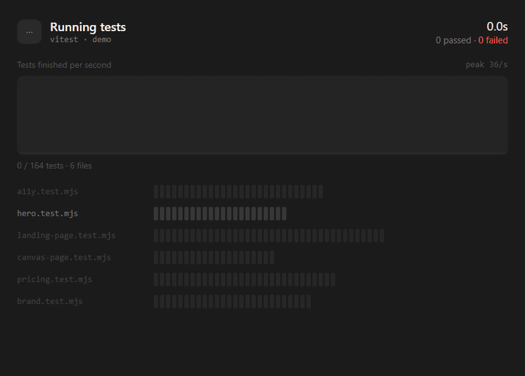

# vitest-viz

A live visual reporter for [Vitest](https://vitest.dev). Watch a run as it happens: tests finishing per second, one row of cells per file, failures marked in red and clickable.



The terminal reporter still works as usual. `vitest-viz` runs next to it, serves a page on localhost while the tests run, and saves the finished run as a single HTML file you can open and scrub through later.

## Install

```bash
npm install --save-dev vitest-viz
```

Requires Vitest 4 or later (tested on 4.1 and 5.1) and Node 20 or later. Vitest 5 itself needs Node 22.

## Use

Add it to your Vitest config, next to the default reporter:

```js
// vitest.config.js
import { defineConfig } from "vitest/config";
import VizReporter from "vitest-viz";

export default defineConfig({
  test: {
    reporters: ["default", new VizReporter()],
  },
});
```

Run your tests. Vitest prints a link:

```
vitest-viz: live at http://127.0.0.1:7378/
```

Open it. When the run ends, the reporter writes the replay to `.vitest-viz/index.html`. Add that folder to `.gitignore`.

Prefer to switch it on only when you want it? Gate it on an environment variable:

```js
reporters: ["default", ...(process.env.VIZ ? [new VizReporter()] : [])],
```

## What you see

The header shows run status, elapsed time and the passed and failed counts. It ends on a green tick, or a red cross with the failure count.

The graph plots tests finished per second, with a dot at the head. Each failure drops a red line.

There is one row per test file and one cell per test. Grey is waiting, green passed, red failed and light grey skipped. A file's cells appear as soon as Vitest collects it, so you see the size of the run up front.

With many files the page shows 8 rows: failing files first, then running ones, then the most recently finished. The rest collapse into "+N more files", which you can expand. Click a red cell for the test name and its error message.

The Slowest panel under the rows lists the five slowest tests so far, updating as they finish. Switch it to Files to rank files by duration. The bar is relative to the slowest item, and a failed test's bar is red.

After the run, open `.vitest-viz/index.html` to replay it. You can play, pause, scrub and change speed. It needs no server and no network.

Watch mode works. The page resets on each rerun.

## Options

```js
new VizReporter({
  outFile: ".vitest-viz/index.html", // where the replay goes, relative to the Vitest root
  port: 7378, // live page port; a free one is used if it is busy
  live: true, // false: skip the server and only write the replay
  open: false, // true: open the live page in an app window (see below)
  title: "vitest · my-app", // text under the heading
});
```

## Open a window automatically

Set `open: true` (or run with `VITEST_VIZ=open`) and the reporter opens the live page in a small app window. This needs [`playwright-core`](https://www.npmjs.com/package/playwright-core) and a Playwright Chromium (`npx playwright-core install chromium`).

It only ever launches Playwright's own Chromium. It never opens your default browser, and if Playwright or Chromium is missing it prints the URL and carries on. A single run (not watch mode) waits for you to close the window, for up to a minute, so you can read the result.

## Security

The server listens on `127.0.0.1` only and refuses requests whose `Host` header isn't a local address, so a web page you visit can't read your test output through DNS rebinding. The page shows test names and error messages, so treat it like your terminal output. Nothing is sent anywhere.

## How it works

The reporter listens to Vitest's reporter hooks and records each result with a timestamp. While the run is going it streams them to the page over server-sent events. A page that connects late gets the history first. When the run ends it embeds the whole log into `template.html` and writes the result to a file. There are no runtime dependencies: the reporter uses Node built-ins and the page is plain HTML, CSS and JS.

## Limits

- Vitest only. Other runners have different hooks.
- Tested on Vitest 4.1 and 5.1 on Windows with Node 24. CI runs Linux and Windows on Node 22 with Vitest 5 and on Node 20 with Vitest 4. I haven't tried browser mode or sharded runs.
- Cell widths shrink to fit, so a file with thousands of tests gets very thin cells.

## Develop

```bash
npm install
npm test        # starts the real Vitest CLI against demo/ and checks the replay, the live server and the Host check
npm run demo    # runs the demo suite with the reporter attached
npm run gif     # re-records docs/demo.gif (needs ffmpeg)
```

See [CONTRIBUTING.md](CONTRIBUTING.md).

## Licence

MIT. Not affiliated with the Vitest team.
